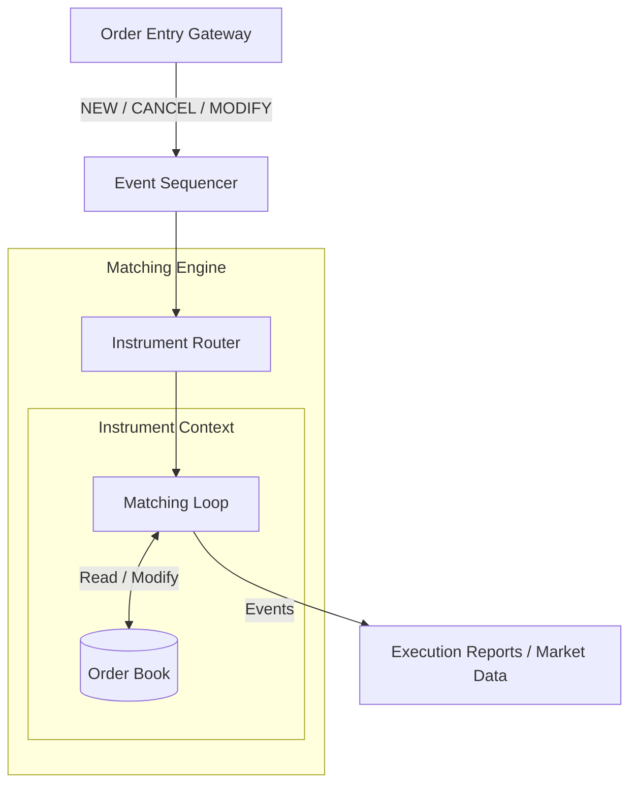

# Matching Engine

A matching engine is a sophisticated software system that brings together
buyers and sellers in financial markets. It serves as the operational 
core of an exchange, connecting parties who want to buy an asset with
those looking to sell it, and vice versa. Its primary function is to
execute trades quickly, accurately, and impartially, creating a level
playing field for all market participants.

## Architecture Overview

When orders come arrive at matching engine, they first must be routed to a instrument specific order book. Every instrument that an exchange supports (in this case our backtesting engine) has a separate [order book](./order-book.md).

After the order is routed to a specific instrument context, [matching loop](./matching-loop.md) decides what to do with the order based on order type (`NEW` / `CANCEL` / `MODIFY`).

When processing the order is completed, necessary events are generated and are sent to their handlers.

This is a simplified overview of what matching engine does:

## Specific elements of Matching Engine

As You can see, matching engine has couple submodules that need to communicate between each other. To learn about them, check out:

- [Order Book](./order-book.md)
- [Matching Loop](./matching-loop.md)
